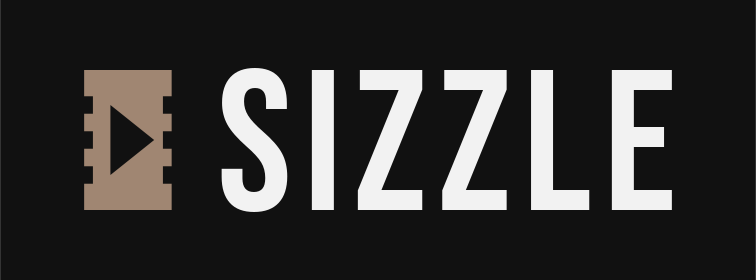
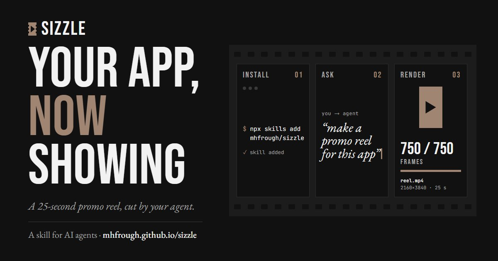
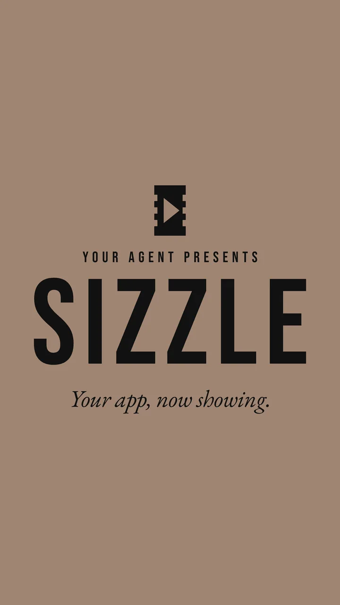

<h1></h1>

A 25-second promo reel for your app, cut by your AI agent.

[](https://mhfrough.github.io/sizzle/)

<p>
  <a href="https://mhfrough.github.io/sizzle/assets/media/sizzle-reel.mp4"></a>
</p>

The Sizzle trailer, made by Sizzle about itself. Click the poster to play it.

Sizzle is a skill that makes short vertical promo reels (9:16, 20-25 s) for software products. It works
with any AI agent that can read files and run commands.

**Site:** https://mhfrough.github.io/sizzle/

You ask for a reel. The agent studies your product, writes a script and builds the reel as an HTML
animation from your product's real UI. It shows you the reel and waits for your approval. Then it
renders a frame-exact 4K MP4 with licensed music whose drop lands on the reveal.

Named after the *sizzle reel*, the short promo cut used to pitch a show or a product.

## Install

Any agent that reads skills (Claude Code, Codex, Cursor, Gemini CLI, OpenCode and more):

```bash
npx skills add mhfrough/sizzle
```

Claude Code only, macOS / Linux:

```bash
curl -fsSL https://mhfrough.github.io/sizzle/install.sh | sh
```

Claude Code only, Windows (PowerShell):

```powershell
irm https://mhfrough.github.io/sizzle/install.ps1 | iex
```

By hand: copy `skills/sizzle/` to `~/.claude/skills/sizzle/` (Claude Code), or put it in your repo and add
one line to your project's `AGENTS.md`: "For promo reels, follow `skills/sizzle/SKILL.md`." Any other agent
or chat: paste `skills/sizzle/SKILL.md` in and give it shell access to run the tools.

`SKILL.md` follows the open Agent Skills format: YAML front matter (`name`, `description`) then plain
Markdown, so it also reads as ordinary instructions.

## Requirements

- Node 18+ with Playwright: `npm i -D playwright && npx playwright install chromium`
- Python 3.10+: `pip install -r skills/sizzle/tools/requirements.txt`
- No ffmpeg needed

## Files

```
skills/sizzle/
  SKILL.md       the playbook, with approval gates
  AGENTS.md      a short entry for agents that look for that name
  templates/     starter reel, script template, render config
  tools/         renderer, encoder, music sync, one-command runner
  references/    craft, pitfalls, music, case studies
index.html       the project page (GitHub Pages), with site.css and site.js
screening.*      the Screening Room: a three.js cinema that plays the trailer
studio.*         the Cutting Room: type your app's name and cut a reel in the browser
schedule.*       the production schedule: the seven steps and their two approval gates
promo/           the Sizzle trailer, made with Sizzle: reel HTML, script, render config, fonts
assets/          share image, the trailer, its poster and frames (assets/media/), three.js (assets/vendor/three/)
                 and the page fonts, Bebas Neue and EB Garamond (assets/fonts/, SIL OFL 1.1)
install.sh       one-line installer for Claude Code (macOS / Linux)
install.ps1      one-line installer for Claude Code (Windows)
```

## The page

Static files, no build step. Serve the folder (`python -m http.server 8140`) and open it. Straight after
the title, the page screens Sizzle's own trailer, made by running the skill on this repository
(`promo/`), in a small three.js cinema that loads only when you scroll to it. The page plays a
web copy (720 x 1280) of the 4K render. Three.js is vendored in `assets/vendor/three/`,
and so are the fonts, so nothing loads from a CDN. Its art direction was dealt and checked with
[Taste Skill](https://www.tasteskill.dev/).

Music in the trailer: "Upbeat Future Bass - So Easy" by BombinSound, under the Pixabay Content License.

## Licence

MIT. Made by Mohammad Hamza ([@mhfrough](https://github.com/mhfrough)). The page fonts, Bebas Neue and
EB Garamond, are under the SIL Open Font License 1.1; the licence texts are in `assets/fonts/`.
